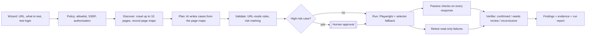

# Phase 1 — Live URL testing

> **Goal:** anyone enters a URL they are allowed to test plus "what to test" in the dashboard, and within 5 minutes gets evidence-backed results: confirmed bugs with screenshots and network logs, clearly separated from things Trevyn could not check. No source code access needed.
>
> **Status at start (24 Oct 2026):** the pipeline runs end to end on a live site (verified on saucedemo.com through Supabase, Redis, the Celery worker and the Playwright runner). What is missing is test *quality* on unfamiliar sites, login support, and the checks that need no AI at all.
>
> **Estimate:** Phase A ≈ 6.5 days, Phase B ≈ 3 days, for one developer. Items marked *(parallel)* can run alongside others.

---

## Contents

1. [Where we start](#1-where-we-start)
2. [Scope](#2-scope)
3. [How a live-URL run will work](#3-how-a-live-url-run-will-work)
4. [Phase A — must-have](#4-phase-a--must-have)
5. [Phase B — should-have](#5-phase-b--should-have)
6. [Safety rules for live sites](#6-safety-rules-for-live-sites)
7. [Contracts and data changes](#7-contracts-and-data-changes)
8. [Testing strategy](#8-testing-strategy)
9. [Definition of done](#9-definition-of-done)
10. [Build order and ownership](#10-build-order-and-ownership)
11. [Risks](#11-risks)
12. [Manual setup checklist](#12-manual-setup-checklist)

---

## 1. Where we start

| Works today | Weak or missing |
|---|---|
| New run wizard creates or reuses a project by URL; black-box is suggested when only a URL is given | No project picker or per-project history |
| Plan → approve → run → live log (SSE) → findings, on Supabase + Redis + Celery | Without an AI key, non-demo sites only get 2 smoke tests |
| Playwright runner: step interpreter, allowlist guard, screenshots, trace, network and console logs, duplicate-POST detection | The planner never sees the real page, so its selectors often miss |
| Deterministic verifier: confirmed / needs review / inconclusive | No retest without a reset hook, so most real-site failures stay "needs review" |
| SSRF guard, OPA policy, human gates, signed run manifests | No login handling; no passive security, error or slowness checks |
| AI adapters: Claude, Gemini, OpenRouter (`MODEL_PROVIDER`) | OpenRouter adapter untested with a real key |

---

## 2. Scope

**In scope:** black-box testing of one live site per run, through the browser, using an AI planner fed with what the site really contains, plus software checks that need no AI.

**Out of scope for Phase 1:** repository access (gray/white-box), automatic patches for live sites, load testing, active security scanning, multi-user scenarios, visual diffing, accessibility audits, scheduled runs.

---

## 3. How a live-URL run will work



Division of work stays as before: **the AI proposes (cases, page reading, explanations); software decides** (what runs, what counts as a bug, permissions, retries).

---

## 4. Phase A — must-have

### A1 · Turn AI on and verify the provider *(0.5 day)*

**Goal:** a real model writes the plan, diagnosis and copilot answers.

**Backend**
1. Put the key in `.env` as `LLM_API_KEY` (never in chat or git). `MODEL_PROVIDER=openrouter`, `LLM_BASE_URL=https://openrouter.ai/api/v1`.
2. Add `scripts/check_models.py`: calls `GET {LLM_BASE_URL}/models`, prints whether each configured `LLM_MODEL_*` id exists, and makes one tiny structured call per node to confirm JSON output works.
3. Fix any model id that does not exist; prefer a cheap fast model (`*-flash`, `*-mini`) for `planner` during development, a stronger one for demos.
4. `/readyz` already reports `"ai": true`; add `"provider"` and the planner model to it.

**Done when:** `check_models.py` passes for all four nodes; `tests/try_url.py https://www.saucedemo.com "…"` prints `source=model`.

---

### A2 · Page discovery — explorer lite *(1.5 days)*

**Goal:** before planning, Trevyn looks at the real site so the planner uses labels, buttons and routes that actually exist.

**Backend**
1. New module `workers/playwright-runner/trevyn_runner/discover.py`:
   - Start at the project URL; breadth-first over same-host links; stop at **10 pages**, **depth 2**, **60 s** total.
   - Never submit forms, never click buttons that look destructive (`delete|remove|pay|buy|order|checkout|confirm|submit` are recorded, not clicked).
   - Respect the allowlist guard already in the runner.
   - For each page record a **page map**: URL path, title, headings (h1–h3), links (text + path), buttons (accessible name), form fields (label, type, required), and whether a login form is present.
   - Use Playwright's accessibility snapshot (`page.accessibility.snapshot()` or `locator.aria_snapshot()`), trimmed to 4 KB per page; redact values of password and hidden inputs.
2. Contract `PageMap` and `SiteMap` in `packages/contracts` (see §7).
3. Store the site map as evidence (`kind="site_map"`) on the plan, so reviewers see what the planner saw.
4. Orchestrator: plan generation for a URL project runs `discover` first, then passes the site map to the planner **inside `<observed_content>`** (page text is untrusted; the prompt-injection rule already applies).
5. Cache the site map per project for 1 hour; a "Re-scan site" action forces a fresh crawl.

**Frontend**
- Plan page: a "What Trevyn saw" panel listing discovered pages with their main buttons and forms.
- Wizard: progress text "Scanning the site (n/10 pages)…" while discovery runs.

**Done when:** on saucedemo.com the site map lists the login form fields by label; on the-internet.herokuapp.com it finds ≥ 10 example pages; no form is submitted during discovery (checked in the network log).

---

### A3 · URL-mode planner rules *(0.5 day)*

**Goal:** the planner only writes tests that can run on a site Trevyn does not control.

**Backend** (`workers/orchestrator/trevyn_orch/planner.py`)
1. A `mode="url"` system prompt variant: black-box only; use locators from the site map; prefer `role=`/`label=` locators; 3–6 cases; each case must assert something specific (text, URL, count, status).
2. Validator rules when the environment has **no hook**:
   - reject `reset` steps and `db_row_count` assertions;
   - every `goto` must be a path seen in the site map or the start URL;
   - any step whose target name matches `pay|buy|purchase|order|delete|remove|send|transfer|confirm` marks the case `risk: high` and `side_effects: ["writes"]`.
3. One repair round with the validator errors (exists), then fall back to the smoke plan (exists).
4. Store `plans.source = "model+sitemap"` so reviewers know the plan was grounded.

**Done when:** a unit test feeds a recorded site map and asserts that every generated case uses only paths and labels from it; a plan with a "Place order" click is marked high-risk.

---

### A4 · Test login *(1 day)*

**Goal:** test pages behind a login without the credentials ever reaching the AI or the evidence.

**Backend**
1. Projects get an optional **test account**: username stored in `environments.test_user`, password stored only as a secret (`environments.secrets_ref` pointing to the local secret store; Supabase Vault later). Migration `0003_test_account`.
2. Planner sees only placeholders: `{{username}}`, `{{password}}`. The validator rejects any plan containing the real values.
3. Runner substitutes placeholders at step time from job-scoped env vars, and adds the real values to its redaction list so screenshots (masked password fields already), logs, traces and network files never contain them.
4. Discovery (A2) logs in first when credentials exist, so pages behind login are mapped too.

**Frontend**
- Wizard step 1: "Test account (optional)" — username and password fields, with the note "Use a test account. The password is never shown to the AI or stored in evidence."
- Project settings: replace or remove the test account.

**Done when:** saucedemo.com logs in as `standard_user`; a grep of the run's evidence folder and the database finds no occurrence of the password.

---

### A5 · Selector fallback — light self-healing *(1 day)*

**Goal:** when a site's labels differ slightly from the plan, the run continues instead of going inconclusive.

**Backend** (`trevyn_runner/runner.py`)
1. When a step's locator matches nothing within 5 s, try in order: role with the same name → label → exact visible text → case-insensitive partial text → the closest accessible name on the current page by token overlap (≥ 0.6).
2. Never fall back for destructive names (A3 list) — those must match exactly.
3. Record `healed: {from, to, method}` on the step result; the verifier treats a healed step as OK, the evidence shows it, and the finding notes "selector healed".
4. Count heals per run; more than 3 heals marks the run "plan drift — re-scan suggested".

**Frontend**
- Live log and finding page show a "healed" pill on steps that used a fallback.

**Done when:** a test page where "Log in" was renamed "Sign in" still passes, with the heal recorded; a renamed "Delete account" button does not heal.

---

### A6 · Safe retest *(0.5 day)*

**Goal:** confirm real-site failures without side effects.

**Backend** (`pipeline.py` / `graph.py`)
1. A failed case with no `side_effects` and no high risk is re-run once in a fresh browser context.
2. Fails again → `confirmed` (reproduced 2/2); passes → `needs_review`, reason `flaky`.
3. Side-effecting cases are never retried on live sites; their verdict states "not repeated: changes data".

**Done when:** a deterministic failure on the-internet.herokuapp.com is `confirmed 2/2`; the verdict for a side-effecting case says why it was not repeated.

---

### A7 · Passive checks on every test *(1 day)* *(parallel)*

**Goal:** free coverage from facts the runner already sees. Pure software, no AI.

**Backend**
1. Runner records response headers and `Set-Cookie` for the top-level document and same-host requests.
2. New module `trevyn_orch/passive.py` with rules, each producing at most one finding per run per rule:

| Rule | Check | Severity |
|---|---|---|
| P1 | Missing `Content-Security-Policy` | medium |
| P2 | Missing `X-Frame-Options` and no `frame-ancestors` in CSP | medium |
| P3 | Missing `Strict-Transport-Security` on HTTPS | medium |
| P4 | Missing `X-Content-Type-Options: nosniff` | low |
| P5 | Session-like cookie without `HttpOnly`, `Secure` (on HTTPS) or `SameSite` | medium |
| P6 | `Server` / `X-Powered-By` header reveals a version | low |
| P7 | Mixed content (HTTP resource on an HTTPS page) | medium |
| P8 | Console errors (uncaught exceptions) | medium |
| P9 | Failed requests: same-host 5xx, or 4xx on resources the page needs | high for 5xx |
| P10 | Slow requests: same-host document or API call over 2 s | low |

3. Findings get `category = security | network | ui`, `status = confirmed` (these are deterministic facts), and the evidence is the network or console file plus the exact header.
4. Rules are configurable per project (`policies` row) so a team can switch one off with a reason.

**Frontend**
- Findings list: filter by category; passive findings carry a "Check P5" style label linking to a short explanation.

**Done when:** the demo shop with `BUGS=all` produces P1–P4 findings (planted bug B8) and none with B8 fixed; saucedemo.com results match a manual header inspection.

---

### A8 · Project picker and run history *(0.5 day)* *(parallel)*

**Backend:** `GET /api/projects/{id}/runs` (paginated), `PATCH /api/projects/{id}` (name, allowlist, retention).

**Frontend**
1. Wizard step 1: choose an existing project or "New site"; choosing one fills the URL and test account.
2. Projects page: real project cards (last run, open findings, pass rate) with "New run" per project.
3. The top-bar project switcher filters Runs, Findings and Board to that project.

**Done when:** two projects can be tested back to back without their runs or findings mixing.

---

## 5. Phase B — should-have

| # | Work | Days | Done when |
|---|---|---|---|
| B1 | **Network page on real data**: wire `/api/insights/network`; add per-request timings by recording a HAR (`record_har_path`, `mode=minimal`) with header and cookie redaction | 1 | The waterfall shows real timings; no `Authorization`/`Cookie` values in stored HARs |
| B2 | **More browsers**: Firefox and WebKit engines, plus a 390×844 phone viewport, selectable in the wizard | 0.5 | One plan runs on all three engines; findings note the engine |
| B3 | **Run report**: one page per run (summary, top findings, passive results, evidence links), printable, plus a short AI-written summary from the run's facts only | 1 | Report for the Sauce Demo run fits on one A4 page |
| B4 | **Export tests**: passing journeys as Playwright `.spec.ts` files for the team's own CI | 0.5 | Exported spec passes with `npx playwright test` |

---

## 6. Safety rules for live sites

These are enforced in code, not left to the AI.

1. **Authorisation:** creating a project requires the "I own or am allowed to test this site" confirmation; it is written to the audit log with the user and time.
2. **Allowlist:** the runner aborts any request to a host outside the project's allowlist (plus explicitly allowed CDNs).
3. **SSRF guard:** private, loopback and metadata addresses are refused unless `ALLOW_PRIVATE_TARGETS=1` on a developer machine.
4. **No writes without a person:** cases that submit, buy, send, delete or change data are high-risk and wait for approval at a gate.
5. **Gentle load:** at most 1 run per site at a time, discovery paced to ≤ 2 pages/s, no load tests or attack payloads in Phase 1.
6. **Credentials:** test accounts only; passwords never reach the AI, logs, traces, screenshots or the database in plain text.
7. **Honest verdicts:** if a step cannot run, the result is *inconclusive*, never *passed*.

---

## 7. Contracts and data changes

**New contracts** (`packages/contracts/trevyn_contracts`):

```python
class PageMap(BaseModel):
    path: str
    title: str
    headings: list[str]
    links: list[dict]          # {text, path}
    buttons: list[str]         # accessible names
    fields: list[dict]         # {label, type, required}
    has_login_form: bool

class SiteMap(BaseModel):
    start_url: str
    pages: list[PageMap]
    crawled_at: str
    truncated: bool

class StepResult(...):          # existing, extended
    healed: dict | None = None  # {from, to, method}

class PassiveFinding(BaseModel):
    rule: str                  # "P1".."P10"
    category: Literal["security", "network", "ui"]
    severity: Literal["high", "medium", "low"]
    message: str
    evidence: dict             # {url, header|cookie|status|timing}
```

**Database** (migration `0003`): `environments.test_user`, `environments.secrets_ref`, `plans.site_map_evidence_id`, `findings.category` values extended, `policies` rows for passive-rule switches.

**API**

| Method | Path | Purpose |
|---|---|---|
| POST | `/api/projects/{id}/discover` | Run or refresh the site map |
| GET | `/api/projects/{id}/site-map` | Latest site map |
| PUT | `/api/projects/{id}/test-account` | Set or clear the test account (password write-only) |
| GET | `/api/projects/{id}/runs` | Run history for one project |
| PATCH | `/api/projects/{id}` | Edit name, allowlist, retention |

---

## 8. Testing strategy

| Level | What | Where |
|---|---|---|
| Unit | Site-map trimming and redaction, URL-mode validator rules, selector fallback order, passive rules P1–P10, placeholder substitution and secret redaction | `tests/test_phase1_*.py`, no browser |
| Recorded pages | Saved HTML of 3 practice sites served locally, so discovery and fallback tests are deterministic | `tests/fixtures/sites/` |
| End to end | `tests/try_url.py` against saucedemo.com, the-internet.herokuapp.com, demo.playwright.dev/todomvc and the demo shop | Manual + nightly CI job (allowed: these sites exist for automation practice) |
| Security of Trevyn | Grep evidence and DB for the test password; confirm no request left the allowlist | Part of the E2E job |

---

## 9. Definition of done

Run against **Sauce Demo, the-internet.herokuapp.com, Playwright TodoMVC and the team's hosted URL**:

- [ ] ≥ 80% of generated test cases are evaluated (not inconclusive)
- [ ] Sauce Demo `standard_user` checkout journey passes with no false bugs
- [ ] Sauce Demo `problem_user` produces ≥ 1 confirmed finding with screenshot and network evidence
- [ ] Passive checks report the same headers a manual inspection shows
- [ ] A full run (discovery + plan + execution + verification) finishes in under 5 minutes
- [ ] No irreversible action ran without approval (audit log shows each gate decision)
- [ ] The test password appears nowhere in evidence, logs or the database
- [ ] Two projects tested back to back keep separate runs and findings
- [ ] All unit tests and both existing E2E scripts still pass

---

## 10. Build order and ownership

| Order | Item | Days | Depends on | Owner |
|---|---|---|---|---|
| 1 | A1 AI on | 0.5 | API key | — |
| 2 | A7 Passive checks | 1 | — (parallel) | — |
| 3 | A8 Project picker | 0.5 | — (parallel) | — |
| 4 | A2 Discovery | 1.5 | — | — |
| 5 | A3 URL-mode rules | 0.5 | A1, A2 | — |
| 6 | A4 Test login | 1 | A2 | — |
| 7 | A5 Selector fallback | 1 | A2 | — |
| 8 | A6 Safe retest | 0.5 | — | — |
| 9 | Phase B (B1–B4) | 3 | Phase A | — |

**Critical path:** A1 → A2 → A3 → A4 → A5 (≈ 4.5 days). A6, A7, A8 can be built alongside.

---

## 11. Risks

| Risk | Impact | Mitigation |
|---|---|---|
| Model ids differ on the gateway or a model returns invalid JSON | Plans fall back to smoke tests | `check_models.py`; schema validation + one repair round + smoke fallback |
| Sites with heavy JavaScript or bot protection block the crawler | Empty site map | Wait for network idle, honest "could not scan" message; never try to bypass bot protection |
| Self-healing clicks the wrong element | False pass or false bug | Exact match required for destructive names; heals recorded as evidence; > 3 heals flags the run |
| Testing a site without permission | Legal and ethical risk | Authorisation confirmation, audit row, allowlist, no attack traffic |
| Credentials leak into evidence | Security incident | Placeholders for the AI, runner-side substitution, exact-value redaction, grep check in tests |
| Costs grow with large prompts | Budget overrun | Site map capped at 10 pages × 4 KB; cheap model for planning in development; token budget per run (exists) |

---

## 12. Manual setup checklist

Before starting Phase 1:

1. `uv sync` (and `cd apps/web && npm install`) when PyPI and npm are reachable.
2. In `.env`: paste `LLM_API_KEY`; keep `MODEL_PROVIDER=openrouter`.
3. Keep Redis running: `docker compose -f infra/docker-compose.yml up -d redis`.
4. Start API, worker, demo shop and dashboard (see `README.md` → Getting started).
5. Run `uv run python scripts/check_models.py` (added in A1) and fix any model id it reports.
6. Rotate the Supabase database password (it was shared in chat) and update `DATABASE_URL`, URL-encoding `$` as `%24` and `#` as `%23`.
