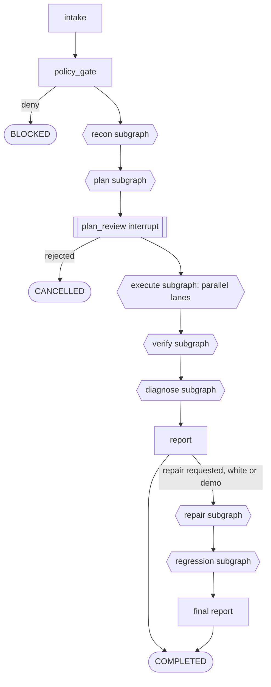

# Testing modes — full build plan (black, grey, white)

> **Goal:** three working testing pipelines that share one LangGraph orchestrator, with every dashboard page updating live while runs execute.
> **Written:** 24 Oct 2026 · **Builds on:** [PROGRESS1.md](PROGRESS1.md) (current state) and [PHASE1.md](PHASE1.md) (live-URL / black-box work in progress).
> **Rule that applies everywhere:** the AI proposes; deterministic software decides what runs, what counts as a bug, permissions, retries and budgets.

---

## Contents

1. [Where we are](#1-where-we-are)
2. [The three modes](#2-the-three-modes)
3. [Orchestrator architecture (LangGraph)](#3-orchestrator-architecture-langgraph)
4. [Subgraphs in detail](#4-subgraphs-in-detail)
5. [Live updates on every page](#5-live-updates-on-every-page)
6. [The live run view](#6-the-live-run-view)
7. [Data model and API changes](#7-data-model-and-api-changes)
8. [Sandboxing and infrastructure](#8-sandboxing-and-infrastructure)
9. [Delivery phases](#9-delivery-phases)
10. [Definition of done per mode](#10-definition-of-done-per-mode)
11. [Risks](#11-risks)
12. [Where each change lands (file map)](#12-where-each-change-lands-file-map)

---

## 1. Where we are

| Area | State |
|---|---|
| LangGraph run graph | 4 nodes: `start → gate (interrupt for high-risk cases) → run_cases → verify_report`; SQLite checkpointer on Windows, Postgres on Linux; resume after approval works across restarts |
| Black-box (URL) | Page discovery exists (`trevyn_runner/discover.py`: ≤ 10 pages, depth 2, 60 s); planner has URL-mode rules and receives the site map; smoke fallback without AI; `scripts/check_models.py` exists |
| Grey/white inputs | `PUT/GET/DELETE /api/projects/{pid}/repository` exist; planner accepts a `repository_map` — no clone, build or code tools yet |
| Live updates | Only the live run page streams (SSE, `real-run-view.tsx`). Other pages refresh through short server caches on navigation |
| Executors | Browser (Playwright) only. No API, security, performance or code-test executors |
| Verification and repair | Deterministic verifier V1–V7; repair loop proved on the demo shop only |

---

## 2. The three modes

The mode is chosen from what the user gives Trevyn; the wizard already recommends it.

| | **Black-box** | **Grey-box** | **White-box** |
|---|---|---|---|
| **User gives** | URL (+ optional test account) | URL + API description (OpenAPI URL/file) and/or read-only repo access | URL (or nothing) + repo with build access |
| **Trevyn can see** | Rendered pages, network traffic, headers | + API contract, routes, data models, optional server logs | + all source code, tests, dependencies, build output |
| **Recon** | Crawl the site, map pages | + Import API spec, map repo routes and models | + Clone, build and start the app in a sandbox, map code |
| **Test types** | UI journeys, passive security, network, smoke performance, accessibility | + API contract, auth matrix, idempotency, injection probes (safe markers), log correlation | + Repo's own unit/integration tests, coverage, SAST (Semgrep), dependency CVEs (OSV), secrets, mutation-guided tests |
| **Repair** | Repair prompt only | Repair prompt pointing at the likely file | Real patch → rebuild → regression → draft PR |
| **Coverage claim** | Pages and journeys exercised | + Endpoints exercised | + **Measured line/branch coverage** |
| **Main risk** | Testing a site without permission | Leaking spec/log data to the model | Running untrusted code — must be sandboxed |

A run can mix modes per executor (e.g. white-box code tests plus black-box browser tests against the sandboxed build); the run's mode is the highest level of access it used.

---

## 3. Orchestrator architecture (LangGraph)

### 3.1 Parent graph

One parent graph per run. Mode decides which subgraphs run and which nodes inside them are enabled.



### 3.2 Shared state (`RunState`)

References only, never blobs, so checkpoints stay small:

```python
class RunState(TypedDict):
    run_id: str
    mode: Literal["black", "grey", "white"]
    target: dict                      # base_url, allowed_hosts, hook_url, sandbox_url
    site_map_id: str | None           # black recon output
    api_spec_id: str | None           # grey recon output
    repo_snapshot_id: str | None      # grey/white recon output (commit, file map)
    build_id: str | None              # white: sandbox build
    plan_id: str
    lanes: dict[str, LaneState]       # ui, api, security, perf, a11y, code: status + job ids
    case_results: list[str]           # evidence/job ids per case
    verdict_ids: list[str]
    finding_ids: list[str]
    budget: dict                      # tokens, minutes, pages, requests used vs limits
    pending_gate: str | None          # approval id while interrupted
    cancel: bool
```

### 3.3 Cross-cutting behaviour

| Concern | How |
|---|---|
| **Checkpointing** | Every node boundary; `thread_id = run uuid`. Postgres saver on Linux, SQLite on Windows (see PROGRESS1 §7) |
| **Human gates** | `interrupt()` in `plan_review`, before any high-risk case, before patch apply, before active scans or load above the threshold. Decision endpoint dispatches `run.resume` |
| **Parallel lanes** | `execute` fans out with LangGraph `Send` — one branch per lane; lanes write to their own state keys; a join node waits for all |
| **Budgets** | `budget` checked at each node entry; over budget → node degrades (rules only, fewer cases) and emits `budget_exceeded` |
| **Cancellation** | Every node and runner job checks `cancel`; parked runs cancel immediately (exists: `cancel_waiting`) |
| **Retries** | Infra errors retried by Celery (max 2); assertion failures never retried automatically — the verifier decides repeats |
| **Events** | Every node writes `node_started`, `node_finished`, `lane_progress` events (see §5) so the UI can draw the graph live |
| **Determinism** | Conditional edges read state fields only, never model text |

---

## 4. Subgraphs in detail

### 4.1 `intake` + `policy_gate` (all modes)

- **intake:** load project, environment, plan request; decide mode from inputs; resolve secrets references; set budgets.
- **policy_gate:** SSRF guard, allowlist, OPA decision (`run.start` with mode, lanes, risk), authorisation flag present. Deny → `BLOCKED` with reasons.

### 4.2 `recon` subgraph

| Node | Black | Grey | White | What it does |
|---|:-:|:-:|:-:|---|
| `discover_site` | ✓ | ✓ | ✓* | Crawl ≤ 10 pages (exists); login first when a test account exists |
| `passive_scan` | ✓ | ✓ | ✓ | Headers, cookies, mixed content, console errors on discovered pages |
| `import_api_spec` | | ✓ | ✓ | Fetch/parse OpenAPI (URL, file, or found in repo); normalise endpoints, auth schemes |
| `map_repo` | | ✓ | ✓ | Read-only clone (shallow); detect stack; map routes → files, models, existing tests |
| `build_sandbox` | | | ✓ | Build and start the app in Docker (§8); health check; expose `sandbox_url` |
| `seed_data` | | | ✓ | Run the repo's seed/migrate commands or a Trevyn fixture script inside the sandbox |

\*White-box discovers against the sandbox URL, not production.

Output: `site_map_id`, `api_spec_id`, `repo_snapshot_id`, `build_id`.

### 4.3 `plan` subgraph

| Node | Purpose |
|---|---|
| `draft_cases` | AI writes cases per lane from requirement + recon outputs (site map, spec, repo map) inside `<observed_content>` |
| `validate_cases` | Deterministic rules: allowed actions/hosts, ≥ 1 assertion, URL-mode rules, endpoint exists in spec, file exists in repo |
| `repair_cases` | One AI repair round with validator errors |
| `risk_score` | Software scoring: writes/deletes/payments → high; endpoints with side effects → medium+; AI risk note is advisory |
| `select_cases` | Fit to budget: keep highest risk × coverage gain; drop duplicates |
| `fallback` | No AI or repeated invalid output → templates (demo), smoke (black), spec-derived contract tests (grey), repo's own tests only (white) |

Then `plan_review` interrupt (auto-approved for low-risk plans when the project's autonomy policy allows).

### 4.4 `execute` subgraph — parallel lanes

| Lane | Black | Grey | White | Engine | Notes |
|---|:-:|:-:|:-:|---|---|
| `ui` | ✓ | ✓ | ✓ | Playwright (exists) | Selector fallback (PHASE1 A5); Chromium + Firefox + WebKit + phone viewport |
| `network` | ✓ | ✓ | ✓ | Playwright HAR | Timings, failed/slow requests, duplicate POSTs, third-party inventory |
| `security_passive` | ✓ | ✓ | ✓ | Rules on captured traffic | P1–P10 (PHASE1 A7) |
| `security_dast` | ✓ (baseline) | ✓ | ✓ | OWASP ZAP in Docker | Passive baseline by default; active scan only behind approval, never production |
| `a11y` | ✓ | ✓ | ✓ | axe-core injected into pages | WCAG A/AA violations |
| `perf_smoke` | ✓ | ✓ | ✓ | Web vitals from browser runs | LCP, CLS, TTFB per page |
| `api` | | ✓ | ✓ | httpx + schema validation | Contract, status, auth matrix (no token / other user), idempotency |
| `perf_load` | | ✓ | ✓ | k6 | Small load by default; above threshold needs approval |
| `code_tests` | | | ✓ | Repo's pytest / Vitest / JUnit in sandbox | Results normalised from JUnit XML |
| `sast` | | (read-only) ✓ | ✓ | Semgrep | Grey runs on the read-only clone |
| `sca` | | ✓ | ✓ | OSV-Scanner | Lockfile CVEs |
| `secrets` | | ✓ | ✓ | gitleaks | Repo history scan |
| `coverage` | | | ✓ | Language coverage tools + browser-side instrumentation | Produces measured line/branch % |

Each lane: `prepare → run_jobs (Celery, per queue) → collect_evidence`. Lanes report `lane_progress` events. A join node `lanes_done` waits for all lanes or their timeouts.

### 4.5 `verify` subgraph

| Node | Purpose |
|---|---|
| `classify` | Existing V1–V7 rules per case → confirmed / needs_review / inconclusive / passed |
| `repeat_safe` | Re-run read-only failures (PHASE1 A6); white-box can reset the sandbox and repeat anything |
| `dedupe` | Same case + assertion + observed value → `duplicate_of` |
| `group_failures` | AI clusters related failures ("all checkout tests fail at payment step"); software keeps the evidence links |
| `flaky_check` | pass→fail→pass pattern → flaky badge; AI suggests why (timing, data, network) |
| `scanner_triage` | Scanner hits (ZAP, Semgrep, OSV) start as needs_review; AI explains, software never auto-confirms them |

### 4.6 `diagnose` subgraph

| Node | Black | Grey | White |
|---|:-:|:-:|:-:|
| `hypothesise` (AI over evidence) | ✓ | ✓ | ✓ |
| `correlate_logs` (server logs around the failure timestamp) | | ✓ | ✓ |
| `locate_code` (route → handler file, stack trace → line) | | ✓ | ✓ |
| `investigate_more` (agent asks for one more targeted test, within budget, max 2 loops) | ✓ | ✓ | ✓ |
| `repair_prompt` | ✓ | ✓ (with file pointers) | ✓ |

### 4.7 `repair` and `regression` subgraphs (white-box, and demo shop)

1. `propose_patch` — AI diff against the cloned commit, limited files.
2. `diff_guard` — exists: size, secrets, test-file edits.
3. `patch_review` — interrupt; approver ≠ requester.
4. `apply_and_build` — `git apply` in a fresh sandbox, rebuild, health check.
5. `select_regression` — exists: original case + same requirement + same routes + smoke; white adds tests covering changed files (from coverage map).
6. `run_regression` — re-enters `execute` with the pinned plan version against the patched sandbox.
7. `compare` — exists: fixed / still failing / new failure / unchanged.
8. `open_pr` — optional: push branch `trevyn/fix-<DEF>-<n>`, draft PR via GitHub App.
9. Loop up to 3 attempts, then escalate.

### 4.8 `report`

Deterministic run summary (counts, verdicts, coverage, lanes run/not run with reasons) + AI-written narrative from those facts only + signed manifest (exists).

---

## 5. Live updates on every page

### 5.1 Event model

Postgres stays the source of truth; Redis pub/sub is only the doorbell (exists for runs).

| Channel | Events |
|---|---|
| `run:{id}` (exists) | `state`, `log`, `step`, `assertion`, `gate`, `verdict`, `diagnosis`, `finding` + new `node_started`, `node_finished`, `lane_progress`, `screenshot`, `heal`, `budget` |
| `project:{id}` (new) | `run_created`, `run_state`, `finding_created`, `finding_updated`, `approval_created`, `approval_decided`, `plan_ready`, `repair_updated`, `site_map_ready`, `insights_changed` |

Every writer that changes a row also publishes the matching project event (one helper: `publish_project(project_id, type, payload)`).

### 5.2 API

- `GET /api/projects/{id}/events/stream` — SSE, ticket-authenticated like run streams, `Last-Event-ID` resume from a `project_events` table (append-only, same pattern as `run_events`).
- `GET /api/stream` — workspace-wide stream for the shell (badge counts, island).

### 5.3 Frontend

1. **One connection per tab:** `useProjectEvents(projectId)` in the workspace layout opens the project stream once.
2. **TanStack Query everywhere:** each page reads through hooks (`useRuns`, `useFindings`, `useApprovals`, `usePlans`, `useRepairs`, `useInsights`); events invalidate or patch the matching query keys.
3. **Page-by-page behaviour:**

| Page | Live behaviour |
|---|---|
| Overview | KPIs, gate, run health and categories refetch on `run_state`/`finding_*`; live island shows active runs with progress |
| Runs | New runs appear instantly; state pills and progress bars update |
| Live run | Graph map, lanes, log, screenshots (§6) |
| Findings / Board | New cards slide in; column moves from other users apply in place |
| Approvals | New requests appear with sound/notification; decided ones leave |
| Plans | `plan_ready` swaps "Generating…" for the plan; explorer proposals appear |
| Repair / Regression | Attempt status, regression progress, comparison rows fill in |
| Network / Security / Perf / A11y / Compat | Refresh on `insights_changed` after each run's report |

4. **Fallback:** if the stream drops, queries poll every 15 s until it reconnects; an offline banner shows when the API is unreachable.

---

## 6. The live run view

Layout (desktop):

| Area | Content |
|---|---|
| Header | Run id, mode badge (Black/Grey/White), target, elapsed time, budget meters (tokens, minutes), Stop button |
| **Graph map** | The parent graph and the active subgraph drawn with React Flow; nodes grey (pending), blue (running), green (done), amber (waiting for approval), red (failed); click a node to filter the log |
| **Lanes** | One row per execute lane (UI, API, Security, Perf, A11y, Code): progress bar, cases passed/failed/inconclusive, current step |
| **Screen** | Latest screenshot per browser case, updated on each `screenshot` event (thumbnail strip, click to enlarge); later: live video frames |
| **Log** | Existing streaming log with actor (AI / DET / HUMAN) and filters by lane and node |
| **Gate panel** | When interrupted: what is asked, why, risk, evidence so far, Approve/Reject |
| **Findings rail** | Findings as they are created, with verdict and link |

Multiple concurrent runs: the island lists them; each run page streams independently.

---

## 7. Data model and API changes

**New tables (migrations 0004+):**

| Table | Purpose |
|---|---|
| `project_events` | Append-only project stream (id, project_id, seq, type, payload, ts) |
| `api_specs` | Imported OpenAPI per project/version (normalised endpoints) |
| `repo_snapshots` | Commit, file map, detected stack, routes → files |
| `builds` | Sandbox builds: image, status, logs ref, sandbox_url, started/ended |
| `lanes` | Per-run lane status, counts, timings |
| `coverage_reports` | Per run: line/branch %, per-file data ref |
| `scanner_results` | Raw ZAP/Semgrep/OSV/gitleaks results before triage |

**New endpoints:**

| Method | Path | Purpose |
|---|---|---|
| POST | `/api/projects/{id}/api-spec` | Upload or link an OpenAPI spec |
| GET | `/api/projects/{id}/api-spec` | Current spec + endpoints |
| POST | `/api/projects/{id}/builds` | Build the repo in a sandbox (white) |
| GET | `/api/builds/{id}` (+ `/logs/stream`) | Build status and live logs |
| GET | `/api/runs/{id}/graph` | Node/lane states for the graph map (initial paint; events update it) |
| GET | `/api/runs/{id}/coverage` | Coverage report |
| GET | `/api/projects/{id}/events/stream`, `/api/stream` | Live streams (§5) |

**Contracts:** `LaneState`, `NodeEvent`, `ApiSpec`, `RepoSnapshot`, `BuildResult`, `CoverageReport`, `ScannerFinding` in `packages/contracts`.

---

## 8. Sandboxing and infrastructure

| Component | Plan |
|---|---|
| **Launcher** | One worker queue (`sandbox`) owns the Docker socket; no other process gets it |
| **Build** | Prefer the repo's `docker-compose.yml`/`Dockerfile`; else detect stack (Node, Python, Java) and use a pinned base image + standard commands |
| **Isolation** | Read-only root, tmpfs work dirs, non-root user, CPU/memory caps, no host mounts except the clone |
| **Network** | Build phase: egress only to package registries (proxy allowlist). Test phase: no egress except the sandbox network |
| **Secrets** | Repo token used only for clone; never mounted into the app container; test accounts injected per job |
| **Clean-up** | Containers, volumes and clones removed after the run; build logs kept as evidence |
| **Scanners** | ZAP, Semgrep, OSV, gitleaks, k6 as pinned images run by the launcher |
| **Compose additions** | `zap`, `k6`, `semgrep` images pulled on demand; `minio` for evidence; Postgres checkpointer on Linux |

---

## 9. Delivery phases

| Phase | Scope | Est. days | Exit |
|---|---|---|---|
| **1 — Black-box complete** | Finish PHASE1.md (A1–A8, B1–B4) | 6–9 | PHASE1 definition of done met |
| **2 — Graph rework + live everywhere** | Parent graph + subgraphs with node events; parallel lanes via `Send`; project event stream; TanStack Query on all pages; live run graph map, lanes, screenshots | 6 | Two concurrent runs update every page live; graph map lights up per node |
| **3 — Black-box breadth** | Lanes: network (HAR), security_passive, ZAP baseline, a11y, perf_smoke, multi-browser | 4 | Each lane produces evidence-backed findings on the practice sites |
| **4 — Grey-box** | API spec import, read-only repo map, API lane (contract, auth matrix, idempotency), Semgrep/OSV/gitleaks on the read-only clone, log correlation, file pointers in repair prompts | 7 | Demo shop with spec: all endpoints contract-checked; seeded API bugs confirmed |
| **5 — White-box** | Sandbox launcher, build, seed, repo tests lane, coverage, k6 load, real patch → rebuild → regression → draft PR | 10 | A real repo (demo shop as a repo) goes finding → patch → verified with measured coverage |
| **6 — Hardening** | Egress proxy, redaction v2, budgets per lane, benchmark harness, recorded-run fallback for demos | 4 | Benchmark report with recall/precision per mode |

**Total ≈ 37–40 days** for one developer; Phases 3 and 4 can overlap with two people.

---

## 10. Definition of done per mode

**Black-box**
- [ ] URL + requirement → plan grounded in the site map → results in < 5 min
- [ ] UI, network, passive security, a11y and web-vitals lanes all report
- [ ] ≥ 80% of cases evaluated on practice sites; no false confirmed bugs on Sauce Demo `standard_user`

**Grey-box**
- [ ] OpenAPI imported; every endpoint has a contract test; auth matrix runs with two test users
- [ ] Semgrep/OSV/gitleaks findings triaged as needs_review with evidence
- [ ] Repair prompts name the likely file and function

**White-box**
- [ ] Repo cloned, built and started in an isolated sandbox with no outbound internet during tests
- [ ] Repo's own tests run and appear as a lane; coverage % measured and shown
- [ ] Confirmed finding → patch → approval → rebuild → regression → verified, with a draft PR

**Live updates (all modes)**
- [ ] Every page reflects run, finding, approval, plan and repair changes within 2 s without reload
- [ ] Live run shows the graph map, lanes, screenshots and gates; survives refresh and reconnect

---

## 11. Risks

| Risk | Mitigation |
|---|---|
| Running untrusted repo code | Sandbox profile (§8); launcher-only Docker socket; egress blocked during tests |
| Builds fail on unfamiliar stacks | Support repos with Dockerfile/compose first; clear "could not build" report with logs; fall back to grey-box |
| Parallel lanes overload a live site | Per-host concurrency limit; DAST and load lanes off by default on live URLs |
| Event storms slow the UI | Throttle `lane_progress`/`screenshot` events (≤ 2/s per run); query invalidation batched |
| LangGraph subgraph state grows | References only in state; evidence in object storage |
| Scanner noise | Scanner results never auto-confirmed; triage node + human review |
| Cost of AI per run | Budgets per lane; cheap models for drafting, stronger for diagnosis; caching of site/repo maps |

---

## 12. Where each change lands (file map)

Existing files are the ones listed in [PROGRESS1.md §2](PROGRESS1.md#2-repository-map); **new** marks files to create. Paths are relative to the repo root.

### 12.1 Orchestrator (LangGraph)

| Plan item | Existing files to change | New files |
|---|---|---|
| Parent graph + subgraphs (§3, §4) | `workers/orchestrator/trevyn_orch/graph.py` (today: `start → gate → run_cases → verify_report`; becomes the parent graph), `pipeline.py` (state table gains recon/lane states) | **new** `trevyn_orch/subgraphs/{recon,plan,execute,verify,diagnose,repair,regression}.py`, **new** `trevyn_orch/state.py` (`RunState`, `LaneState`) |
| Node events (§5.1) | `services/api/trevyn_api/runs.py` (`Ctx.log`/`state` emit `node_started`, `node_finished`, `lane_progress`) | — |
| Planner per mode (§4.3) | `trevyn_orch/planner.py` (already has URL mode + site map + `repository_map`; add spec-aware and repo-aware prompts, `risk_score`, `select_cases`) | **new** `trevyn_orch/prompts/{planner_black,planner_grey,planner_white}.md` |
| Verify subgraph (§4.5) | `trevyn_orch/verifier.py` (V1–V7 stay), `regression.py` | **new** `trevyn_orch/grouping.py` (failure clusters, flaky analysis), **new** `trevyn_orch/triage.py` (scanner results) |
| Diagnose subgraph (§4.6) | `trevyn_orch/diagnose.py` (add `correlate_logs`, `locate_code`, `investigate_more`) | — |
| Repair/regression (§4.7) | `services/api/trevyn_api/repairs.py` (today switches demo-shop bug flags; add real-patch path), `trevyn_orch/diff_guard.py`, `regression.py` | **new** `trevyn_orch/patcher.py` (apply diff in a fresh clone, rebuild) |
| Model adapters and budgets | `trevyn_orch/models.py` (Anthropic, Gemini, OpenAI-compatible), `scripts/check_models.py` | **new** `trevyn_orch/budget.py` (per-lane token/minute limits) |
| Celery tasks | `services/api/trevyn_api/worker.py` (add `build.run`, lane tasks per queue) | — |

### 12.2 Execution lanes and recon

| Lane / node | Existing files | New files |
|---|---|---|
| `discover_site` | `workers/playwright-runner/trevyn_runner/discover.py`, `browser.py` | — |
| `ui` lane, selector fallback, multi-browser | `workers/playwright-runner/trevyn_runner/runner.py` | — |
| `network` lane (HAR, timings) | `runner.py` (record HAR + redaction), `services/api/trevyn_api/insights.py` (`/api/insights/network`) | — |
| `security_passive` (P1–P10) | `runner.py` (capture headers/cookies) | **new** `trevyn_orch/passive.py` |
| `a11y`, `perf_smoke` | `runner.py` (inject axe-core, read web vitals) | **new** `trevyn_runner/a11y.py` |
| `security_dast` (ZAP), `perf_load` (k6), `sast` (Semgrep), `sca` (OSV), `secrets` (gitleaks) | `infra/docker-compose.yml` (images) | **new** `workers/scanners/trevyn_scanners/{zap,k6,semgrep,osv,gitleaks}.py` (run container, normalise results) |
| `api` lane, `import_api_spec` | `packages/contracts/trevyn_contracts/__init__.py` (add `ApiSpec`) | **new** `workers/api-runner/trevyn_api_runner/{spec,runner}.py` |
| `map_repo` | repository endpoints in `services/api/trevyn_api/main.py` (`/api/projects/{pid}/repository`) | **new** `trevyn_orch/repo_map.py` (clone read-only, routes → files) |
| `build_sandbox`, `seed_data`, `code_tests`, `coverage` | `infra/docker-compose.yml` | **new** `workers/sandbox/trevyn_sandbox/{launcher,build,tests,coverage}.py`, **new** `infra/docker/seccomp-runner.json` |

### 12.3 Control plane (API, data, policy)

| Plan item | Existing files to change | New files |
|---|---|---|
| New tables (§7) | `services/api/trevyn_api/db.py` | **new** migrations `migrations/versions/0004_project_events.py`, `0005_specs_repos_builds.py`, `0006_lanes_coverage_scanners.py` |
| Project/workspace streams (§5.2) | `runs.py` (add `publish_project`), `main.py` (SSE routes next to `/api/runs/{id}/events/stream`), `auth.py` (ticket covers project streams) | — |
| Spec, build, graph, coverage endpoints (§7) | `main.py`, `plans_ext.py` | **new** `services/api/trevyn_api/{specs,builds,graph_api}.py` (routers) |
| Policy per mode and lane | `services/api/trevyn_api/policy.py`, `infra/opa/trevyn.rego`, `infra/opa/trevyn_test.rego` | — |
| SSRF for sandbox URLs | `services/api/trevyn_api/targets.py` (allow the sandbox network only) | — |
| Evidence for new lanes | `services/api/trevyn_api/storage.py` (new kinds: `har`, `zap_report`, `sarif`, `coverage`, `build_log`) | — |
| Contracts | `packages/contracts/trevyn_contracts/__init__.py`, `__main__.py` (schema export) | — |

### 12.4 Dashboard (`apps/web`)

| Plan item | Existing files to change | New files |
|---|---|---|
| Query layer + live invalidation (§5.3) | `apps/web/lib/api.ts`, `lib/live-data.ts`, `lib/live.tsx`, `components/providers.tsx` | **new** `apps/web/lib/queries.ts` (TanStack Query hooks), **new** `lib/use-project-events.ts` |
| Live run view (§6) | `components/runs/real-run-view.tsx` | **new** `components/runs/{run-graph-map,run-lanes,run-screens,gate-panel}.tsx` |
| Wizard mode inputs | `components/runs/new-run-view.tsx` (mode recommendation exists; add API spec and repo/build fields) | — |
| Pages going live | Overview `app/(workspace)/page.tsx`; runs `components/runs/runs-view.tsx`; findings `components/findings/real-finding-view.tsx`, `repair-panel.tsx`; plans `components/plans/live-plans-view.tsx`; network/security/analytics `components/quality/*` | — |
| Shell indicators | `components/shell/top-bar.tsx` (island), `components/shell/copilot.tsx` (data-source chip) | — |

### 12.5 Tests

| Area | Existing | New |
|---|---|---|
| Unit | `tests/test_core.py`, `test_queue.py`, `test_graph.py`, `test_insights.py`, `test_storage_integrations.py`, `test_phase1_*.py` | **new** `tests/test_subgraphs.py`, `test_lanes.py`, `test_project_events.py`, `test_sandbox_policy.py` |
| End to end | `tests/e2e_golden_path.py`, `tests/e2e_repair_loop.py`, `tests/try_url.py` | **new** `tests/e2e_grey_api.py` (demo shop + OpenAPI), `tests/e2e_white_repo.py` (demo shop as a repo: build → finding → patch → verified) |
| Demo targets | `scenarios/demo-shop/demo_shop/app.py`, `templates.py` | **new** `scenarios/demo-shop/openapi.yaml`, **new** `scenarios/demo-shop/Dockerfile` (so white-box can build it) |
