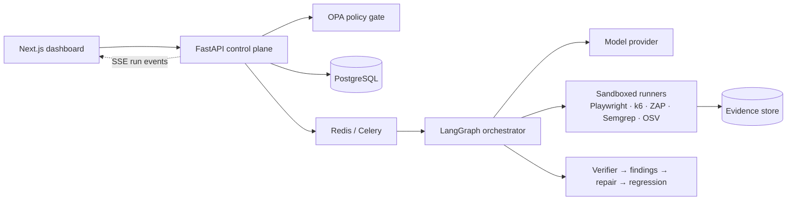

<div align="center">

# Trevyn

### Enterprise Autonomous QA Engineering

**Discover. Verify. Repair. Deliver with Confidence.**

*CODE APEX 3.0 · iMocha track IM-02 — Autonomous AI QA Engineer · Team **Dimaag Ka Dahi***


</div>

---

## What is Trevyn?

Trevyn is an AI QA engineer that plans tests from your requirements and runs them against a real browser and real APIs. It captures evidence (traces, HAR, screenshots, console logs) and checks every failure before calling it a bug. It then writes an evidence-backed bug report, drafts a repair prompt or patch, and reruns the regression suite to prove the fix.

**The model proposes, code decides.** Test runners make the measurements, deterministic rules give the verdicts, and humans approve anything high-impact.

> **The gap we close:** the step from "a test failed" to "a developer can act on it". A failure might be a real defect, a bad test, or an environment problem. Trevyn tells you which, and shows you the proof.

### Worked example: duplicate checkout orders

1. Requirement: *"Placing an order once creates exactly one order."*
2. Trevyn generates a structured test plan, and you approve it.
3. The Playwright runner double-submits checkout. It sees two `POST /api/orders` 180 ms apart and an order count of 2.
4. The verifier confirms it (reproduced 2/2 with fixture reset). The finding **DEF-142** carries the trace, HAR and screenshots.
5. The fix assistant drafts a repair. A human approves it, and Trevyn reruns the original test plus related tests: **before ✗ → after ✓**.

---

## Features

| | Capability |
|---|---|
| 🧭 | **Stack-aware test planning**: requirements → schema-validated test cases (black-, gray- and white-box) |
| 🌐 | **UI testing** with Playwright: traces, HAR, console, screenshots, duplicate-request detection |
| 🔌 | **API & unit tests**: OpenAPI-driven API checks; pytest / Vitest / JUnit adapters |
| ✅ | **Verifier**: deterministic checks (setup, action, assertion, evidence, repeat), with *inconclusive* as an honest outcome |
| 🧪 | **Evidence-backed bug reports**: expected vs actual, repro steps, labelled hypotheses |
| 🛠️ | **Repair & regression loop**: repair prompt or isolated-branch patch → approval → before/after rerun |
| ⚡ | **Performance**: bounded k6 load tests with thresholds |
| 🛡️ | **Security**: OWASP ZAP (passive by default), Semgrep, OSV-Scanner |
| 🖥️ | **Compatibility**: OS × browser matrix via GitHub Actions |
| 🔐 | **Governance**: OPA/Rego policy gate, target allowlists, RBAC, human approvals, append-only audit log |

---

## Project status

| Part | Status |
|---|---|
| Web dashboard (`apps/web`): 23 desktop routes, light-glass design system, live-run view, findings board, repair loop | ✅ Built (runs on **demo data**) |
| FastAPI control plane, PostgreSQL, Redis/Celery | ⏳ Planned |
| LangGraph orchestrator + model adapter (Claude by default) | ⏳ Planned |
| Playwright / k6 / ZAP / Semgrep / OSV runners | ⏳ Planned |
| Planted-bug demo shop + benchmark harness | ⏳ Planned |

The dashboard is currently backed by fixtures and a simulated event stream. The full backend plan, with milestones and a definition of done, is in **[BACKEND_AND_REMAINING_WORK.md](BACKEND_AND_REMAINING_WORK.md)**.

---

## Architecture



---

## Tech stack

**Frontend:** Next.js 16 (App Router, Turbopack), React 19, TypeScript, Tailwind CSS v4, shadcn/ui (Base UI), Recharts, React Flow, motion, dnd-kit, cmdk, TanStack Query, zod

**Backend (planned):** Python 3.12, FastAPI, Pydantic v2, SQLAlchemy + Alembic, PostgreSQL, Redis + Celery, LangGraph, JSON Schema contracts, MinIO/S3

**Testing engines (planned):** Playwright, pytest, Vitest, JUnit, k6, OWASP ZAP, Semgrep, OSV-Scanner, GitHub Actions

**Governance (planned):** OPA/Rego, RBAC, managed secrets, egress-restricted Docker workers, Ed25519 signed run manifests

---

## Repository layout

```text
.
├── apps/web/                        # Next.js dashboard (built)
├── BACKEND_AND_REMAINING_WORK.md    # backend blueprint & remaining-work plan
├── DASHBOARD_DESIGN_SPEC.md         # dashboard layout & component spec
├── GLASS_DESIGN_LANGUAGE.md         # light glassmorphism design language
├── PORTING_PLAN.md                  # prototype → Next.js porting log
└── TREVYN_IM02_DimaagKaDahi.pdf     # pitch deck
```

Planned additions: `services/api`, `workers/*`, `packages/contracts`, `schemas/`, `scenarios/demo-shop`, `infra/` (see the blueprint).

---

## Getting started (dashboard)

**Requirements:** Node.js 20+ and npm. Desktop browser (the UI is desktop-only).

```bash
cd apps/web
npm install
npm run dev            # http://localhost:3000
```

Other scripts:

```bash
npm run build          # production build
npm run start          # serve the production build
npm run lint           # eslint
npm run check:legacy   # flag leftover prototype styling
```

Optional route checks, run from `apps/web` against a running dev server (needs Python + Playwright):

```bash
python scripts/sweep_routes.py      # visit every route, check for errors and broken links
python scripts/e2e_demo_path.py     # scripted demo path
```

---

## Principles

- An LLM can't grant itself permissions or mark a failing test as passed.
- Page and repository content is **untrusted data**, never instructions.
- Every finding cites evidence, or it is labelled inconclusive.
- A patch is "verified" only after the original test and regression tests pass.
- The original failure and its evidence are never overwritten.
- Demo or recorded data is always labelled as such.

---

## Team: Dimaag Ka Dahi

Rohit Kadam · Harsh Dhavane · Abhishek Patil · Aditya Kachwaha

Built for **CODE APEX 3.0**, iMocha problem statement **IM-02: Autonomous AI QA Engineer**.
