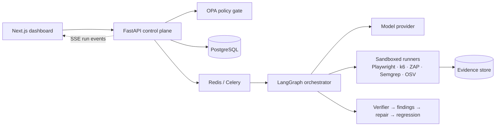

<div align="center">

# Trevyn

### Enterprise Autonomous QA Engineering

**Discover. Verify. Repair. Deliver with Confidence.**

*CODE APEX 3.0 · iMocha track IM-02 — Autonomous AI QA Engineer · Team **Dimaag Ka Dahi***


</div>

---

## What is Trevyn?

Trevyn is an AI QA engineer that plans tests from your requirements and runs them against a real browser and real APIs. It captures evidence (traces, HAR, screenshots, console logs) and checks every failure before calling it a bug. It then writes an evidence-backed bug report, drafts a repair prompt or patch, and reruns the regression suite to prove the fix.

**The model proposes, code decides.** Test runners make the measurements, deterministic rules give the verdicts, and humans approve anything high-impact.

> **The gap we close:** the step from "a test failed" to "a developer can act on it". A failure might be a real defect, a bad test, or an environment problem. Trevyn tells you which, and shows you the proof.

### Worked example: duplicate checkout orders

1. Requirement: *"Placing an order once creates exactly one order."*
2. Trevyn generates a structured test plan, and you approve it.
3. The Playwright runner double-submits checkout. It sees two `POST /api/orders` 180 ms apart and an order count of 2.
4. The verifier confirms it (reproduced 2/2 with fixture reset). The finding **DEF-142** carries the trace, HAR and screenshots.
5. The fix assistant drafts a repair. A human approves it, and Trevyn reruns the original test plus related tests: **before ✗ → after ✓**.

---

## Features

| | Capability |
|---|---|
| 🧭 | **Stack-aware test planning**: requirements → schema-validated test cases (black-, gray- and white-box) |
| 🌐 | **UI testing** with Playwright: traces, HAR, console, screenshots, duplicate-request detection |
| 🔌 | **API & unit tests**: OpenAPI-driven API checks; pytest / Vitest / JUnit adapters |
| ✅ | **Verifier**: deterministic checks (setup, action, assertion, evidence, repeat), with *inconclusive* as an honest outcome |
| 🧪 | **Evidence-backed bug reports**: expected vs actual, repro steps, labelled hypotheses |
| 🛠️ | **Repair & regression loop**: repair prompt or isolated-branch patch → approval → before/after rerun |
| ⚡ | **Performance**: bounded k6 load tests with thresholds |
| 🛡️ | **Security**: OWASP ZAP (passive by default), Semgrep, OSV-Scanner |
| 🖥️ | **Compatibility**: OS × browser matrix via GitHub Actions |
| 🔐 | **Governance**: OPA/Rego policy gate, target allowlists, RBAC, human approvals, append-only audit log |

---

## Project status

Status on 24 Oct 2026, against the 12 steps of the core build guide. "Verified" means it ran end to end on this machine.

| Part | Status |
|---|---|
| Web dashboard (`apps/web`): 23 routes, live runs, findings, board, approvals, plans, repair panel, copilot, login + user menu | ✅ Live API data when `NEXT_PUBLIC_API_URL` is set; demo fixtures otherwise |
| 1 · Database: SQLAlchemy models, Alembic migrations `0001`–`0002`, append-only triggers | ✅ Verified on SQLite and Supabase Postgres |
| 2 · Auth and roles: Supabase JWT, role per route, approver flag, no self-approval of patches, audit log | ✅ Backend verified by unit tests · login page built, not yet tried with a real Supabase project |
| 3 · Job queue: Celery + Redis, DB-backed gates and cancel, Redis doorbell for live events, stale-run reaper | ✅ Verified with Redis (`REDIS_URL`) and without it (in-process) |
| 4 · LangGraph orchestrator: checkpointed graph, gates as interrupts, resume after restart | ✅ Verified on SQLite checkpointer · Postgres checkpointer untested |
| 5 · Plan lifecycle: versions, edit as new version, diff, approve/reject | ✅ API · Plans page lists and approves (no edit/diff screen yet) |
| 6 · Repair and regression loop: patch proposal, diff guard, approval, regression run, before/after comparison | ✅ Verified (`tests/e2e_repair_loop.py`) · demo shop only; real repos need the GitHub integration |
| 7 · Policy and security: OPA/Rego (`infra/opa`), SSRF guard, signed run manifests | ✅ 5/5 Rego tests · OPA used when `OPA_URL` is set |
| 8 · Evidence store: S3/MinIO upload, pre-signed URLs, retention purge | ✅ Unit tests with a fake S3 client · not tried against MinIO/S3 |
| 9 · Insights: Overview KPIs, analytics, network, history | ✅ API + Overview · Analytics/Network pages still on fixtures |
| 10 · Frontend wiring | ✅ Runs, findings, board, approvals, plans, repair, overview, audit |
| 11 · Integrations: GitHub webhook (HMAC), Slack, Jira | ✅ Unit tests · not tried against real services |
| 12 · CI and ops: GitHub Actions, gitleaks, `infra/docker-compose.yml`, `tasks.ps1` | ✅ Workflows written, not yet run on GitHub |
| AI provider | Claude or Gemini (`MODEL_PROVIDER`); with no key, template plans and rule-based diagnosis |
| k6 / ZAP / Semgrep / OSV runners, benchmark harness | ⏳ Not built (Perf/Security/Compat pages say "Not run") |

Tests: 57 unit tests (`uv run pytest -q`), plus `tests/e2e_golden_path.py` and `tests/e2e_repair_loop.py`. The plan is in **[BACKEND_AND_REMAINING_WORK.md](BACKEND_AND_REMAINING_WORK.md)**.

---

## Architecture



---

## Tech stack

**Frontend:** Next.js 16 (App Router, Turbopack), React 19, TypeScript, Tailwind CSS v4, shadcn/ui (Base UI), Recharts, React Flow, motion, dnd-kit, cmdk, TanStack Query, zod

**Backend:** Python 3.12, FastAPI, Pydantic v2, SQLAlchemy + Alembic, PostgreSQL, Redis + Celery, LangGraph, JSON Schema contracts, MinIO/S3

**Testing engines:** Playwright (built); planned: Playwright, pytest, Vitest, JUnit, k6, OWASP ZAP, Semgrep, OSV-Scanner, GitHub Actions

**Governance:** OPA/Rego, RBAC, managed secrets, egress-restricted Docker workers, Ed25519 signed run manifests

---

## Repository layout

```text
.
├── apps/web/                       # Next.js dashboard
├── services/api/trevyn_api/        # FastAPI control plane: runs, plans, findings, repairs, auth, policy, insights, integrations
│   └── migrations/                 # Alembic migrations (Postgres / Supabase)
├── workers/orchestrator/           # LangGraph run graph, planner, verifier, diagnosis, diff guard, regression, model adapters
├── workers/playwright-runner/      # Playwright step interpreter and evidence capture
├── packages/contracts/             # shared Pydantic contracts → schemas/*.json
├── scenarios/demo-shop/            # planted-bug ShopFlow store
├── infra/                          # docker-compose.yml (Redis, Postgres, MinIO, OPA) and opa/ policies
├── tests/                          # unit tests + e2e_golden_path.py, e2e_repair_loop.py
├── .github/workflows/              # CI and secret scanning
├── tasks.ps1                       # Windows task runner
└── BACKEND_AND_REMAINING_WORK.md   # backend blueprint
```

---

## Getting started (dashboard)

**Requirements:** Node.js 20+ and npm. Desktop browser (the UI is desktop-only).

```bash
cd apps/web
npm install
npm run dev            # http://localhost:3000
```

Other scripts:

```bash
npm run build          # production build
npm run start          # serve the production build
npm run lint           # eslint
npm run check:legacy   # flag leftover prototype styling
```

Optional route checks, run from `apps/web` against a running dev server (needs Python + Playwright):

```bash
python scripts/sweep_routes.py      # visit every route, check for errors and broken links
python scripts/e2e_demo_path.py     # scripted demo path
```

---

## Getting started (core)

**Requirements:** Python 3.12+ and [uv](https://docs.astral.sh/uv/). Everything else is optional.

```bash
cp .env.example .env                 # optional: DATABASE_URL (Supabase), ANTHROPIC_API_KEY
uv sync
uv run playwright install chromium
uv run uvicorn demo_shop.app:app --port 3100       # terminal 1: planted-bug shop (BUGS=all)
uv run uvicorn trevyn_api.main:app --port 8000     # terminal 2: control plane, docs at /docs
uv run python tests/e2e_golden_path.py             # terminal 3: plan → approve → run → B1 confirmed
cd apps/web && copy .env.example .env.local && npm run dev   # dashboard on live API data (http://localhost:3000)
```

The dashboard shows a **Live API data** / **Demo data** chip (bottom left). With the API up it reads real runs, findings and approvals; New run launches a real run and streams it at `/runs/live?run=RUN-xxxx`; finding pages show real evidence; **Ask Trevyn** opens the copilot. KPI charts and the quality pages are still demo data. Leave `NEXT_PUBLIC_API_URL` empty for demo-only mode.

- **No `DATABASE_URL`:** local SQLite at `var/trevyn.db`. **Supabase:** use the pooler connection string (port 5432 session mode, or 6543 transaction mode). Tables and append-only triggers are created on startup.
- **No `ANTHROPIC_API_KEY`:** the planner uses template plans and diagnosis uses deterministic rules; the copilot (`POST /api/assistant/chat`) returns 503. With a key, planning, diagnosis, repair prompts and chat use Claude (`claude-opus-5-5`, adaptive thinking).
- **Fix a planted bug:** restart the shop with that flag removed, e.g. `BUGS=email_validation,user_enum uv run uvicorn demo_shop.app:app --port 3100` fixes B1.
- `uv run python -m trevyn_contracts` exports the JSON Schemas to `schemas/`.
- **Postgres / Supabase:** run `uv run alembic upgrade head` once before starting the API (SQLite creates tables on startup).
- **Tests:** `uv run pytest -q` (unit) · `uv run python tests/e2e_repair_loop.py` (needs shop + API running: finds DEF-142, patches, regresses, expects `verified`).
- **Job queue (optional):** set `REDIS_URL=redis://localhost:6379/0` and start a worker with `uv run celery -A trevyn_api.worker worker -Q orchestrator,maintenance --pool=solo` (plus `uv run celery -A trevyn_api.worker beat` for the stale-run reaper). Without `REDIS_URL`, runs execute inside the API process and any run left unfinished by a restart is marked failed on startup.
- **Auth:** `AUTH_MODE=off` (default) runs as a local owner. `AUTH_MODE=supabase` + `SUPABASE_JWKS_URL` (or `SUPABASE_JWT_SECRET`) enforces login and roles; the dashboard login page is not built yet.

---

## Core status and commands

**Windows shortcuts:** `.\tasks.ps1 up | migrate | test | e2e | api | shop | worker | web` (Redis via `infra/docker-compose.yml`). CI (`.github/workflows/ci.yml`) runs ruff + pytest, OPA policy tests, the web type-check/build and a contracts schema drift check; `security.yml` runs gitleaks on PRs.

**Endpoints added in the core build** (full list at `/docs`):

| Area | Endpoints |
|---|---|
| Repairs | `POST /api/findings/{id}/repair-proposals`, `GET /api/repairs`, `GET /api/repairs/{id}`, `POST /api/repairs/{id}/verify`, `GET /api/runs/{id}/comparison` |
| Plan versions | `GET /api/plans`, `PATCH /api/plans/{id}` (new version), `GET /api/plans/{id}/diff`, `GET /api/plans/{id}/runs` |
| Manifest | `GET /api/runs/{id}/manifest`, `POST /api/runs/{id}/manifest/verify` |
| Auth & audit | `GET /api/me`, `POST /api/sse-ticket`, `GET/PUT /api/members`, `GET /api/audit` |
| Insights | `GET /api/dashboard/overview`, `GET /api/insights/analytics`, `GET /api/insights/network`, `GET /api/insights/{perf,security,compat}` (report "Not run" until those engines exist), `GET /api/projects/{id}/history` |
| Integrations | `GET /api/integrations` (status) · `POST /api/webhooks/github` (HMAC) · `POST /api/findings/{id}/jira` · Slack notifications via `SLACK_WEBHOOK_URL` |

**Environment variables**

| Variable | Purpose |
|---|---|
| `AUTH_MODE` | `off` (default, local owner) or `supabase` (JWT + roles; needs `SUPABASE_JWKS_URL` or `SUPABASE_JWT_SECRET`) |
| `REDIS_URL` | Celery queue + live-event doorbell; unset = runs execute in the API process |
| `OPA_URL` | OPA server for policy decisions (policies in `infra/opa`) |
| `S3_*` | S3-compatible evidence store (endpoint, bucket, keys); unset = local `var/evidence` |
| `GITHUB_WEBHOOK_SECRET` | Verifies GitHub webhook signatures |
| `SLACK_WEBHOOK_URL` | Slack notifications |
| `JIRA_*` | Jira issue export (base URL, user, token, project) |

**Supabase note:** the direct host `db.<ref>.supabase.co` is IPv6-only. On IPv4 networks use the **Session pooler** connection string from Supabase → **Connect**.

---

## Principles

- An LLM can't grant itself permissions or mark a failing test as passed.
- Page and repository content is **untrusted data**, never instructions.
- Every finding cites evidence, or it is labelled inconclusive.
- A patch is "verified" only after the original test and regression tests pass.
- The original failure and its evidence are never overwritten.
- Demo or recorded data is always labelled as such.

---

## Team: Dimaag Ka Dahi

Rohit Kadam · Harsh Dhavane · Abhishek Patil · Aditya Kachwaha

Built for **CODE APEX 3.0**, iMocha problem statement **IM-02: Autonomous AI QA Engineer**.
